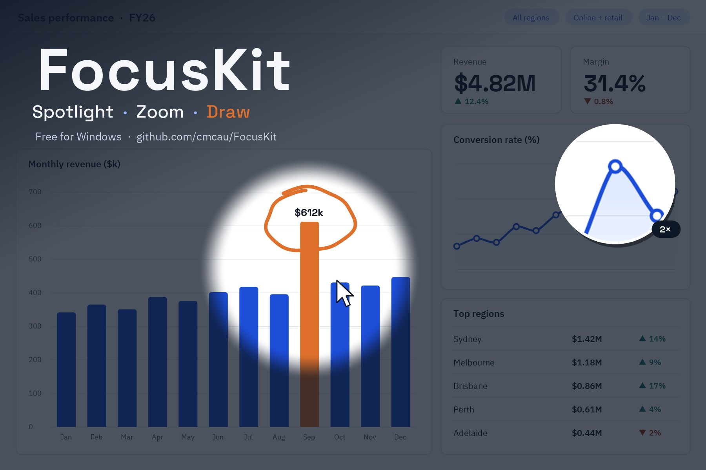

# FocusKit



A tiny Windows tray app that helps your audience see exactly what you're talking about. Press a hotkey to **spotlight** the area around your mouse, **zoom** into the screen, or **draw** on it.

It's built for anyone who shows their screen to other people: presenting in a meeting room, screen-sharing on Teams or Zoom, running training sessions, recording tutorials, or walking a colleague through a dashboard. On a big screen, or a shared screen shrunk into a video call, small details get lost and the mouse pointer is hard to follow. FocusKit lets you:

- **Spotlight** a chart, a button or a line of code, so the audience's eyes go straight to it.
- **Zoom** into small text, tooltips or fine detail without changing your display settings or the app's zoom.
- **Draw** circles, arrows and highlights to point things out, then make them disappear with one key.

All three work over any app and appear instantly from a hotkey, so you don't break the flow of your presentation.

- One small `.exe` (about 50 KB), no installer, no dependencies. It uses the .NET Framework 4.x that already ships with Windows 10 and 11.
- Runs quietly in the system tray.
- Hotkeys are fully configurable.
- Works across multiple monitors and high-DPI / 4K displays.

## Download

Get `FocusKit.exe` from the [latest release](../../releases/latest) and run it. A yellow-dot icon appears in the system tray.

If your email or network blocks `.exe` downloads, grab `FocusKit-vX.Y.Z.zip` from the same release instead. It contains the exe, this README and the licence.

Release files are built from this source code by [GitHub Actions](.github/workflows/build.yml), not on anyone's PC. Each release includes `SHA256SUMS.txt`, so you can confirm your download matches. In PowerShell: `Get-FileHash .\FocusKit.exe`.

> **Windows SmartScreen:** the exe isn't code-signed, so the first time you run it Windows may say *"Windows protected your PC"*. Click **More info → Run anyway**. If you'd rather not trust a downloaded binary, [build it yourself](#building-from-source) from the source in this repo. It takes a few seconds.

## Default hotkeys

| Mode | Hotkey | |
|---|---|---|
| Spotlight | `Ctrl+Shift+1` | Dims every screen except a soft-edged circle that follows your mouse |
| Zoom | `Ctrl+Shift+2` | Zooms into the screen under your mouse |
| Draw | `Ctrl+Shift+3` | Freezes the screen so you can draw on it |

Press the same hotkey again, **Esc**, or **right-click** to leave a mode.

To change the hotkeys, right-click the tray icon and choose **Settings / hotkeys…**, or double-click the icon. Click a box and press the new combination; Backspace clears it.

## Spotlight

- The spotlight follows the mouse, and you can keep clicking and working inside the circle.
- It doesn't take focus away from the app you're presenting (PowerPoint, a browser, etc.).
- **Ctrl + mouse wheel** changes the size of the circle.
- The size and darkness are remembered, and you can also set them in Settings.

## Zoom

- Move the mouse to pan around the zoomed view.
- **Mouse wheel** or **↑ / ↓** zooms in and out (up to 16×).
- **Left-click**, or the Draw hotkey, freezes the zoomed view and lets you draw on it.

## Draw

| Action | How |
|---|---|
| Freehand | drag |
| Straight line | hold `Shift` while dragging |
| Rectangle | hold `Ctrl` |
| Ellipse | hold `Tab` |
| Arrow | hold `Ctrl+Shift` |
| Colours | `R` red, `G` green, `B` blue, `Y` yellow, `O` orange, `P` pink |
| Highlighter on/off | `H` |
| Pen size | mouse wheel, or `+` / `-` |
| Undo | `Ctrl+Z` |
| Erase everything | `E` |
| White / black board | `W` / `K` (press again to go back to the screen) |
| Copy to clipboard | `Ctrl+C` |
| Save as PNG | `Ctrl+S` (saved to `Pictures\FocusKit`) |
| Show this help | `F1` |

## Start with Windows

Tick **Start FocusKit when Windows starts** in Settings. This adds an entry under `HKCU\…\CurrentVersion\Run`; untick it to remove it.

## Building from source

No Visual Studio or SDK needed. The C# compiler is already part of Windows.

```bat
git clone https://github.com/cmcau/FocusKit.git
cd FocusKit
build.cmd
```

This produces `FocusKit.exe` in the same folder. The whole app is a single file, [`FocusKit.cs`](FocusKit.cs) (C# 5, WinForms + a little Win32).

### Making a release

Push a version tag and GitHub Actions builds and publishes the release (exe, zip and checksums):

```bat
git tag v1.1.0
git push origin v1.1.0
```

Every push to `main` is also built, so you can see straight away if something stops compiling.

## Files it writes

| Path | What |
|---|---|
| `%APPDATA%\FocusKit\settings.ini` | your hotkeys and preferences |
| `%APPDATA%\FocusKit\log.txt` | hotkey registration results and any errors, for troubleshooting |
| `Pictures\FocusKit\` | drawings saved with `Ctrl+S` |

To uninstall, untick "Start with Windows", exit from the tray menu, then delete the exe and the folders above.

## Troubleshooting

- **A hotkey does nothing:** another app may already own that combination. FocusKit shows a tray notification if it can't register one, and `log.txt` records it. Pick a different combination in Settings.
- **Antivirus warning:** while the spotlight is on, FocusKit briefly installs low-level keyboard and mouse hooks so it can catch `Esc` and `Ctrl+wheel` without taking focus from your app. Some security tools flag that pattern. The hooks are removed as soon as the spotlight closes, and the full source is here to inspect.
- `FocusKit.exe --selftest` (with the normal copy exited first) opens each mode briefly and writes timings and results to `log.txt`.

## License

[MIT](LICENSE)
